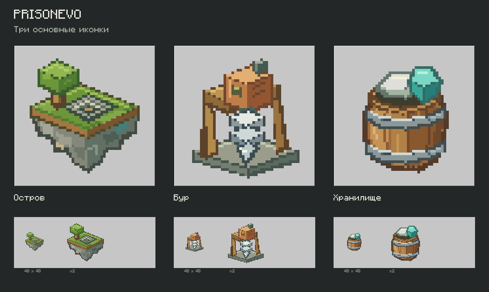
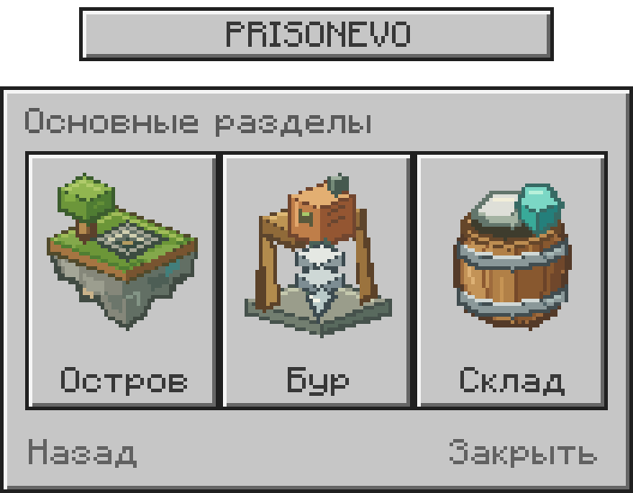

# PrisonEvo — три основные иконки, вариант 3

Три оригинальные иконки 48×48 с прозрачным фоном: остров с карьером, вертикальный бур и хранилище. Формы, грани, контуры и блики заданы вручную целочисленными координатами в `source/draw.py`. Ни генератор изображений, ни рендерер с текстурами блоков для этих трёх иконок не использовались.

В обзорном изображении сверху масштаб x6, снизу исходные 48×48 и x2. В макете меню используются те же PNG в исходном размере; вся панель показана в масштабе x4. Увеличение только nearest-neighbor.

- `png/island.png`
- `png/drill.png`
- `png/storage.png`
- `three-icons.png` — прозрачный лист 144×48, три ячейки по 48×48 слева направо.
- `source/draw.py` — редактируемый исходник.
- `source/menu-font.json` — пиксельные формы игрового шрифта для воспроизводимого превью; оригинал шрифта — Minecraft / Mojang.
- `PrisonEvo-three-icons-v3.zip` — весь набор.

Для пересборки: Python 3, `python -m pip install Pillow`, затем `python source/draw.py`.

Это графический вариант трёх значков и макет их размещения. Новые обработчики меню, JAR или настройки Nexo в этом наборе не менялись.
