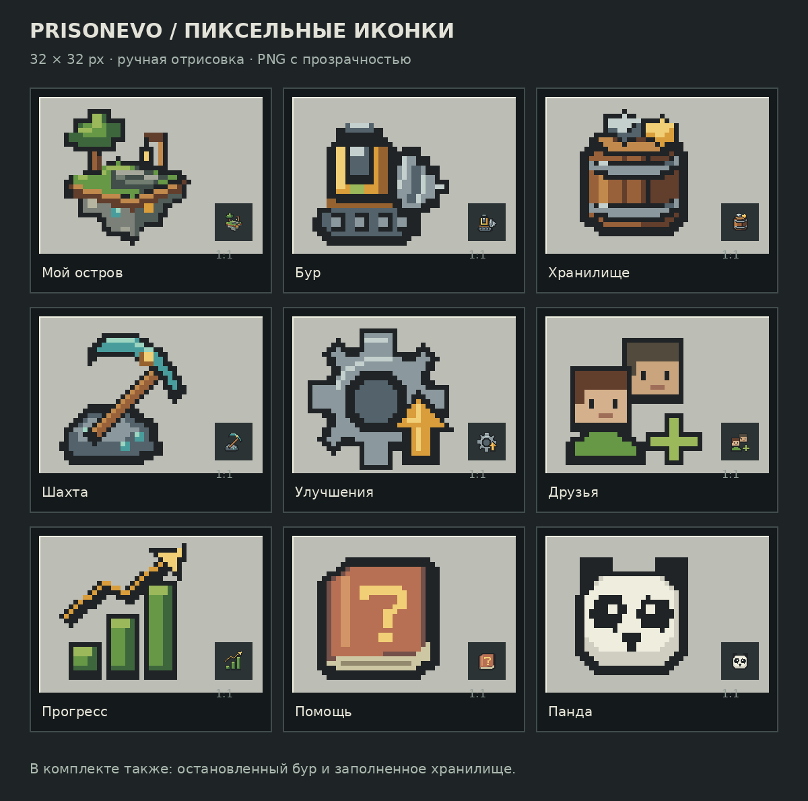

# PrisonEvo — пиксельные иконки

21 иконка для меню личных шахтёрских островов Minecraft. Формы отрисованы кодом по целочисленным координатам; генератор изображений не использовался.



## Скачать

Нажмите **Code → Download ZIP**, чтобы скачать весь набор. Отдельные прозрачные PNG находятся в [`png/`](png/).

Каждая иконка — **32×32 пикселя, RGBA PNG**, с прозрачным фоном. При увеличении используйте **nearest-neighbor** и целый коэффициент масштаба.

## Состав

- Остров, бур, хранилище, шахта, улучшения.
- Друзья, прогресс, помощь, панда.
- Остановленный бур и заполненное хранилище.
- Уголь, железо, золото, редстоун, лазурит и алмаз.
- Назад, закрыть, на спавн, продажа.

[`atlas.png`](atlas.png) — прозрачный атлас 224×96: 7 колонок, 3 ряда, ячейка 32×32. Порядок иконок слева направо и сверху вниз указан в [`manifest.json`](manifest.json).

[`primary-icons.png`](primary-icons.png) — увеличенные остров, бур и хранилище. Превью увеличены без сглаживания; подписи на обзорном листе не входят в текстуры.

## Редактирование и сборка

Исходник: [`source/draw_icons.py`](source/draw_icons.py).

```bash
python -m pip install -r requirements.txt
python source/draw_icons.py
```

Для сборки превью скрипту нужны шрифты DejaVu Sans по стандартному Linux-пути `/usr/share/fonts/truetype/dejavu/` (Debian/Ubuntu: пакет `fonts-dejavu-core`). Скрипт пересоздаёт PNG, атлас, превью и ZIP рядом с папкой проекта.

## Подключение к серверу

Это набор графики, **не установленный ресурс-пак и не плагин**. Конфигурацию Nexo, привязку к слотам меню и действия кнопок нужно подготовить по существующим файлам сервера. Подписи следует выводить отдельно игровым шрифтом.
