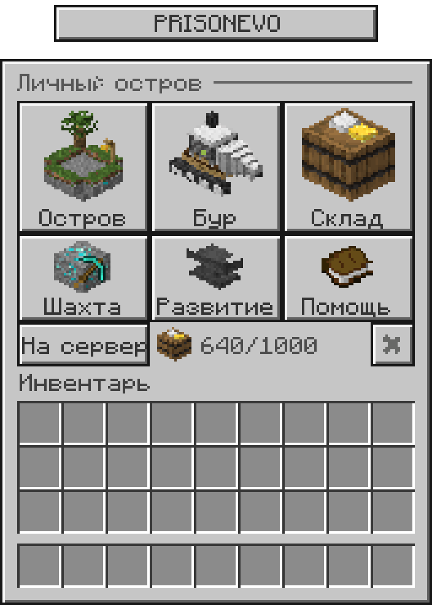
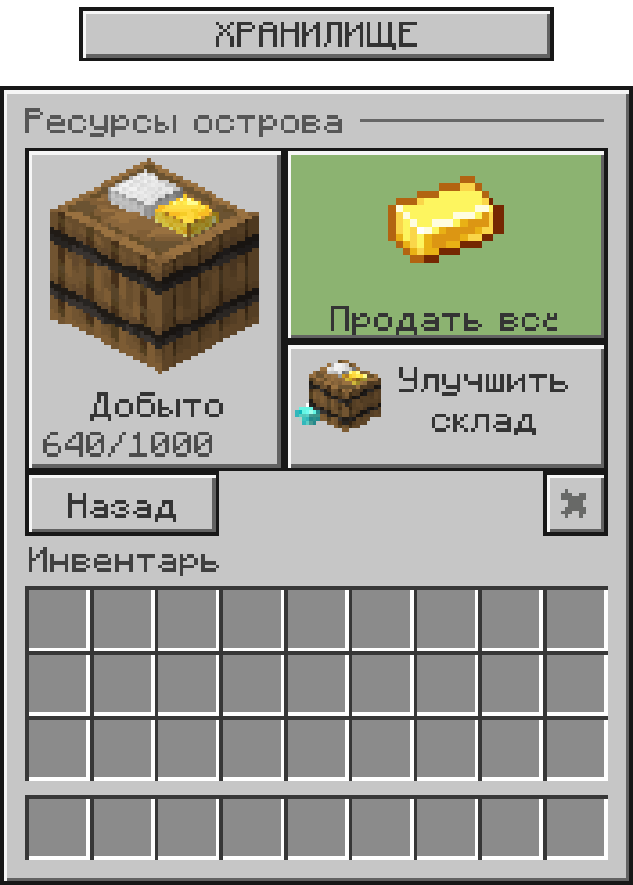

# PrisonEvo UI v2 — оформление под интерфейс сервера

Переработанная версия: объёмные объекты с ванильными фактурами Minecraft, серые панели с одно-пиксельными рамками и настоящий игровой bitmap-шрифт. Иконки построены кодом из геометрии и текстур Minecraft 1.21.8; генератор изображений не использовался.

 

Превью собраны из тех же PNG, которые лежат в ресурс-паке. Это не скриншоты запущенной игры. Числа на превью демонстрационные; в плагине они берутся из IslandData.

## Что скачать

- **[Полный комплект ZIP](PrisonEvo-UI-v2.zip)** — пак, тестовый JAR, инструкция и исходники.
- **[Ресурс-пак для Minecraft 1.21.8](PrisonEvo-UI-resourcepack-1.21.8.zip)** — обычный ZIP с `pack.mcmeta` в корне.
- **[JAR для проверки на Paper 1.21.8](plugin/prisonevo-0.1.1-ui.jar)** — собран по исходникам тестовой PrisonEvo 0.1.0 из этого репозитория.
- **[Как установить и проверить](INSTALL_RU.md)**.
- **[Посмотреть все экраны](previews/menus.png)** и **[иконки](previews/icons.png)**.

Открыв ZIP или JAR на GitHub, нажмите **Download raw file** (значок скачивания). В мобильном интерфейсе загрузка может находиться в меню файла.

## Реализовано

Шесть экранов: главное меню, общий склад, бур, шахта, улучшения и помощь. Продажа и покупки используют внутренние монеты существующего плагина. Карточки целиком кликабельны; предметы-кнопки имеют пустую модель. Свои данные и предметы игрока не используются в качестве кнопок.

В исходной тестовой версии склад — один счётчик общей добычи, поэтому в интерфейсе нет выдуманного учёта ресурсов по видам. Система приглашений и отдельный экран прогресса в этой версии не реализованы; их кнопки не добавлены. Дополнительные иконки для них оставлены в `png/` как графические заготовки.

На складе и в главном меню показана заполненность. На экране бура — уровни и выход за цикл. На экране шахты — уровень и время до сброса. Точные значения, баланс, цены и параметры доступны при наведении. Данные обновляются при открытии меню и после действий; секундного обновления открытого экрана пока нет.

## Файлы и размеры

- `png/` — 22 отдельные прозрачные иконки 64×64.
- `resourcepack/assets/prisonevo/textures/gui/` — шесть PNG 256×256 с прозрачным полем справа.
- `resourcepack/assets/prisonevo/font/` — собственные шрифты фона, отступов и чисел.
- `resourcepack/assets/prisonevo/items/` и `models/item/` — современные item model definitions, включая невидимую кнопку.
- `plugin-source/` — полный исходник тестового плагина и тесты.
- `source/build_art.py` — воспроизводимая сборка графики: Python 3, Pillow, официальный клиентский JAR 1.21.8.

Ресурс-пак использует только namespace `prisonevo`; файлов в `assets/minecraft` нет. Никакие существующие шрифты сервера не заменяются. Раскладка соответствует сундуку на 54 слота; изображение панели занимает 176×222 игровых пикселя, плашка заголовка выступает сверху на 24 пикселя.

## Проверки и ограничения

JAR собран для Java 21 / Paper API 1.21.8. Пройдены 7 JUnit-тестов, включая исходные проверки расчёта добычи и разметку кликабельных карточек. Проверены ссылки моделей/шрифтов, прозрачность, размеры PNG, pack_format 64 и целостность ZIP. Результат: [VALIDATION.txt](VALIDATION.txt).

Клиент Minecraft и рабочий сервер здесь не запускались. Точное совпадение положения фона и текста нужно проверить в игре. Текущий Nexo-пак не предоставлен, поэтому его объединение и размещение в исходной папке Nexo не выполнены. Для проверки пак можно подключить отдельно на клиенте; для выдачи всем игрокам требуется добавить `assets/prisonevo` в существующую сборку Nexo по её реальной структуре.

Vanilla textures and glyph artwork: Minecraft / Mojang. Пользовательские геометрия и сборка интерфейса: `source/build_art.py`. Клиентский JAR в комплект не включён.
